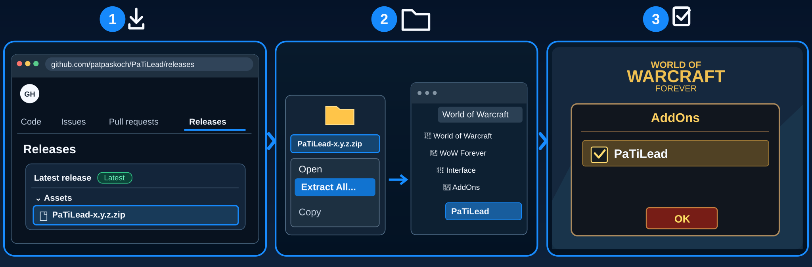

# PaTiLead

## Install

**📥 [Download PaTiLead Beta](https://github.com/patpaskoch/PaTiLead/releases/download/v0.4.0-beta.1/PaTiLead-0.4.0-beta.1.zip)** · [Installation guide](#installation)

*Installation-test preview — not yet a stable release.*

## What is PaTiLead?

**Lead the pull. Keep the party in sync.**

Great groups run on clear signals. PaTiLead puts raid markers, ready checks and pull countdowns right where you need them, so everyone knows the plan before the fight begins. **Less confusion. More coordination.**

## Features

- **Mark your targets:** Place or clear raid markers with a click.
- **Ready when you are:** Start a ready check before the pull.
- **Countdown together:** Choose a three-, five- or ten-second pull timer.
- **Keep the plan visible:** See the target, leader, assistants and role counts.
- **Make it yours:** Choose your markers, shortcuts and a compact layout.

## Installation

1. 📥 **Download** – Open [GitHub Releases](https://github.com/patpaskoch/PaTiLead/releases) and download the `PaTiLead-<version>.zip` file under **Assets** (not **Source code (zip)**).
2. 📂 **Extract & Copy** – Right-click the ZIP, select **Extract All**, then copy the extracted `PaTiLead` folder into the WoW Forever client's `Interface/AddOns/` folder. No renaming is needed.
3. ☑️ **Enable in Game** – Start WoW, open the **AddOns** menu at character selection, tick **PaTiLead**, and click **OK**.

💡 **Tip – Find your WoW installation folder:** In the **Battle.net launcher**, select your WoW version, click the **gear icon next to Play**, and choose **Show in Explorer** (*Im Explorer anzeigen*). This opens the game's installation location in **Windows File Explorer**. From there, open `Interface/AddOns/` (or choose the correct WoW version folder first, if needed).

## Getting Started

- Target an enemy, click a marker
- `/plead settings` → marker order; the "Key bindings" section shows where to bind keys
- `/plead test` shows example data

## Settings

`/plead settings` or ••• → Settings: pull buttons, group info, note, window lock, language, scale, marker
order, and the **Key bindings** note with the menu path.
- **Window:** panel opacity (30–100 %)

## Important notes

> **Installation-test beta available:** [Download the current ZIP from Releases](https://github.com/patpaskoch/PaTiLead/releases). This is an unverified preview for testing the installation, not a stable release.

> Status: in development, not yet stable. Not yet tested in game since the rework.
>
> PaTiLead is the former **PaTiGroup** (renamed 2026-10-02, history kept). The name PaTiGroup now belongs to a new,
> small party-awareness addon (who is tank, healer, what the tank targets). Settings of the old PaTiGroup are not
> taken over: PaTiLead starts with its own `PaTiLeadDB`.

## Key bindings

Every marker, Clear and Show/Hide PaTiLead can get its own key in WoW's key binding menu:

**ESC > Key Bindings > PaTiLead** (German client: **ESC > Tastaturbelegung > PaTiLead**; some clients:
ESC > Options > Key Bindings). The exact path in the Forever client is not yet confirmed.

PaTiLead never sets a key. Keys bound to the old PaTiGroup entries must be bound again under PaTiLead.

## PaTiSuite

This addon is part of the **PaTiSuite** — a collection of small addons for World of Warcraft: Forever.
Each one is installed on its own and works on its own; none of them is needed by another.

- [PaTiSuite](https://github.com/patpaskoch/PaTiSuite) – optional control panel to show and hide the PaTi windows
- [PaTiHeal](https://github.com/patpaskoch/PaTiHeal) – healing: party frames, heal target, click casting, HoTs, dispels
- [PaTiAuras](https://github.com/patpaskoch/PaTiAuras) – buffs, procs, tracking, group buffs and weapon imbues
- [PaTiAggro](https://github.com/patpaskoch/PaTiAggro) – aggro for tank, healer and damage (formerly PaTiTank)
- [PaTiRota](https://github.com/patpaskoch/PaTiRota) – your own skill priority with cooldowns and fixed cast buttons
- [PaTiGroup](https://github.com/patpaskoch/PaTiGroup) – party awareness: tank, healer, roles and the tank's target
- **PaTiLead** – lead the group: raid markers, ready check and pull timer *(this addon)*
- [PaTiQuest](https://github.com/patpaskoch/PaTiQuest) – selected quest and its objectives
- [PaTiDungeon](https://github.com/patpaskoch/PaTiDungeon) – instance, group and combat status
- [PaTiSocial](https://github.com/patpaskoch/PaTiSocial) – "Party Social": quick emote and message buttons
- [PaTiAlerts](https://github.com/patpaskoch/PaTiAlerts) – one window for open problems

### Goes well with (optional)

- [PaTiGroup](https://github.com/patpaskoch/PaTiGroup) – shows everyone the tank's target and its marker
- [PaTiSuite](https://github.com/patpaskoch/PaTiSuite) – shows and hides this window together with the other PaTi windows

## Commands

`/plead` or `/patilead` — alone or `toggle`: show/hide · `settings` · `test` · `show` · `hide` · `lock` · `unlock` ·
`reset` (position) · `debug` · `version` · `about` · `changelog`

The bar cannot be shown, hidden, collapsed or rearranged in combat (it has secure buttons).

## Known limitations

- Markers, Reset All and key bindings are not yet tested in game since the rework.
- Up to version 0.4 the old PaTiGroup created the macro `PaTiG_Reset`. It is no longer used or changed; you may
  delete it (`/plead debug` shows whether it still exists).

## Development

Architecture, tests and engineering rules of the suite: [PaTiAdmin](https://github.com/patpaskoch/PaTiAdmin). PaTiAdmin is not a WoW addon — players do not install it. The shared UI code (PaTiShared) is already embedded in this addon's `Shared/` folder; there is nothing extra to install.

## License

MIT — see [LICENSE](LICENSE). Copyright (c) 2026 Patrick Koch.
